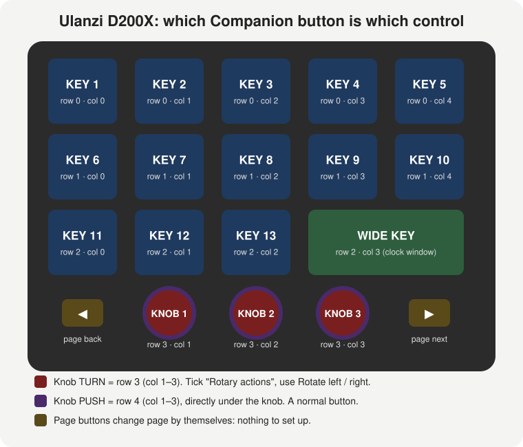

# Setup guide: from a brand-new Mac to everything working

Follow the steps in order. Each step says what you should see when it worked. If something doesn't match, stop and check **Troubleshooting** at the bottom.

You will set up:
- **Part A:** Ulanzi D200X: all keys and knobs in Companion
- **Part B:** Panasonic PTZ (AW-HE40): knob pan/tilt/zoom/focus and hold-to-save presets
- **Part C:** UAD Console (Apollo): mutes, faders, monitor

- **Part D:** DiGiCo SD9: snapshots, mutes, faders and monitor sends on the D200X
- **Part E:** Show health page: green/red keys for every device, and alerts
- **Part F:** grandMA2 (lighting): executor faders on the knobs, Go/Pause/Flash keys with cue names
- **Part G:** Echo360 lecture recording: the auditorium Pro box, and Universal Capture rooms
- **Part H:** ChamSys MagicQ lighting: playback faders on the knobs
- **Part I:** System Tools (was App Launcher): apps, window moving and layouts, keep awake, sound, Shortcuts and more
- **Part J:** NDI router: switch which camera NDI Virtual Input (or a monitor) shows
- **Part K:** NDI Studio Monitor (Windows): source, PiP, mute and record keys
- **Part L:** Spotify: play/pause, volume knob, playlist keys and now playing
- **Part M:** Apple Music (Mac): play/pause, volume knob, your playlists and now playing

You only need the parts for the gear you have. **Part 0 is always needed.**

---

## Quick install (no Terminal): for venue and classroom Macs

Use this when a Mac only needs to *run* the modules. Part 0 below is for a Mac where you also want automatic updates from GitHub.

1. Install **Companion** (step 0.5 below).
2. **Everything in one go (easiest):** download **[companion-tools-all-modules.tgz](https://github.com/Wntr2134/companion-tools/releases/download/latest/companion-tools-all-modules.tgz)**. In Companion, go to **Modules** → **Import offline module bundle** (the blue button; *Import Bundle* in newer Companion) and choose it. Every module, including the D200X plugin, is installed at once. Then skip to step 4.
   - This link always gets the newest build, so bookmark it.
3. **Or just some modules:** open <https://github.com/Wntr2134/companion-tools/releases/tag/latest> and download the `.tgz` for each one you need:
   - `ulanzi-stream-controller-….tgz`: D200X
   - `panasonic-ptz-….tgz`: PTZ cameras
   - `uad-console-….tgz`: Apollo / UAD Console
   - `digico-osc-….tgz`: DiGiCo SD
   - `show-health-….tgz`: show health page (Part E)
   - `grandma2-plus-….tgz`: grandMA2 lighting (Part F)
   - `echo360-capture-….tgz`: Echo360 recording (Part G)
   - `chamsys-magicq-osc-….tgz`: ChamSys MagicQ (Part H)
   - `system-tools-….tgz`: System Tools, was App Launcher (Part I)
   - `ndi-router-….tgz`: NDI router (Part J)
   - `ndi-studio-monitor-….tgz`: NDI Studio Monitor (Part K)
   - `spotify-local-….tgz`: Spotify (Part L)
   - `apple-music-local-….tgz`: Apple Music (Part M)
   Then in Companion: **Modules** → **Import module package**, and choose the file. Repeat for each one.
4. On each connection or surface integration, click the pencil ✏️ next to the version and pick the version you just imported.
5. Carry on from **Part A to M**, skipping the "dev version" steps.

**To update everything later:** download the bundle again from the same link and import it with the same blue **Import offline module bundle** button. Modules that haven't changed are skipped. Then pick the new versions with the pencil ✏️ (step 4). Older versions stay installed until you remove them, so you can switch back if a new one misbehaves.

---

## Part 0: One-time Mac setup (about 15 minutes)

You need an **admin account** for some of these steps. If you're on a standard account, the Mac asks for an admin name and password. That's normal.

### 0.1 Open Terminal
1. Press **⌘ + Space**, type **Terminal**, press **Enter**.
2. A window with a text prompt opens. All the `grey boxes` below get pasted into this window, followed by **Enter**.

### 0.2 Install Apple's developer tools (gives you `git`)
1. Paste:
   ```bash
   xcode-select --install
   ```
2. A pop-up appears. Click **Install** and wait for it to finish (5–10 min).
   - If it says *"command line tools are already installed"*, that's fine. Carry on.

### 0.3 Install Node.js 22
1. Go to <https://nodejs.org/en/download> in a browser.
2. Pick **version 22 (LTS)**, **macOS Installer (.pkg)**. Don't use 24 or 26: these modules are built for 22.
3. Open the downloaded `.pkg` and click through the installer.
4. **Check:** quit Terminal (⌘ + Q), open it again, and paste:
   ```bash
   node -v
   ```
   ✅ You should see `v22.something`.

### 0.4 Turn on Yarn (the installer the modules use)
1. Paste (it asks for your Mac password; typing shows nothing, which is normal):
   ```bash
   sudo corepack enable
   ```
2. **Check:**
   ```bash
   yarn -v
   ```
   ✅ You should see a version number. If it asks *"Do you want to continue? [Y/n]"*, type `y` and press Enter.

### 0.5 Install Companion
1. Go to <https://bitfocus.io/companion> and download **Companion for macOS** (version **4.3 or newer**; 5.x is fine).
2. Drag it into **Applications** and open it.
3. The Companion launcher window appears. Click **Launch GUI**: the Companion web page opens in your browser.

### 0.6 Download this repo
1. Paste:
   ```bash
   git clone https://github.com/Wntr2134/companion-tools ~/companion-tools
   ```
   - If it asks for a GitHub username and password, the repo is private. Sign in with your GitHub account (use a [personal access token](https://github.com/settings/tokens) as the password), or make the repo public.
2. **Check:**
   ```bash
   ls ~/companion-tools
   ```
   ✅ You should see `panasonic-ptz  SETUP-GUIDE.md  tools  uad-console  ulanzi-d200x  update.sh` (and a few more).

### 0.7 Install and build everything
1. Paste:
   ```bash
   bash ~/companion-tools/update.sh
   ```
2. Wait. It runs through three sections (`== ulanzi-d200x`, `== panasonic-ptz`, `== uad-console`).
   - Yellow `warning` lines are normal.
   - If it asks *"Do you want to continue? [Y/n]"*, type `y`.

   ✅ It should finish with `Done.`

### 0.8 Tell Companion where the modules are
1. In the Companion web page, click **Settings** (left menu), then the **Advanced** tab.
2. Find **Developer**.
3. Turn **Enable Developer Modules** **on**.
4. Next to **Developer modules path**, click **Select** and choose the **companion-tools** folder in your home folder.
   - Choose `companion-tools` itself, **not** a folder inside it.
5. Quit Companion completely: on the launcher, click **Quit**, or press ⌘ + Q on the launcher window. Then open it again and click **Launch GUI**.

✅ Part 0 done. You never need to repeat it on this Mac.

---

## Part A: Ulanzi D200X

### A.1 Get Ulanzi's own app out of the way
Ulanzi Studio fights Companion for the device. If it's installed:
1. Quit it, including its **menu-bar icon** at the top right of the screen (click the icon → Quit).
2. Open **System Settings → General → Login Items**. Remove **Ulanzi Studio** if it's listed.

### A.2 Let the Mac accept the device
1. Open **System Settings → Privacy & Security**.
2. Scroll down to **Allow accessories to connect** and set it to **Always**.
3. Plug the D200X **straight into the Mac** with **the cable that came with it**. Don't use a dock, monitor hub or random cable; many USB-C cables only carry power.
4. If the Mac asks *"Allow accessory to connect?"*, click **Allow**.

### A.3 Turn on the plugin in Companion
1. In Companion, click **Modules** (left menu), then the **Surfaces** section/tab.
2. Find **Ulanzi Stream Controller** and make sure it's **enabled**.
3. Click it. Next to **Module Version**, click the **pencil ✏️** and choose the **dev** version. Click **Save**.
   - This step matters. The store version (v1.0.2) has a bug that makes the D200X loop on and off with Companion 5.
4. Click **Surfaces** (left menu), then **Rescan USB**.

✅ The D200X appears in the Surfaces list, and its keys go blank or show Companion buttons.

### A.4 Load the labelled layout page (recommended)
This page labels every key and knob, so you can see which Companion button is which control.

1. Get the file:
   - With the repo on your Mac: `~/companion-tools/ulanzi-d200x/extras/D200X-layout.companionconfig` (in the file picker, ⌘ + Shift + H jumps to your home folder).
   - Without it: download **D200X-layout.companionconfig** from the [latest release](https://github.com/Wntr2134/companion-tools/releases/tag/latest).
2. In Companion, click **Import / Export** (left menu), then **Import**, and choose the file.
3. When asked, import it into an **empty page**.

✅ The D200X shows KEY 1 to KEY 13, WIDE KEY, KNOB 1 to 3 TURN, and KNOB 1 to 3 PUSH (in Companion's grid, under the knobs).



How the D200X maps onto Companion's grid:

| Row | Col 0 | Col 1 | Col 2 | Col 3 | Col 4 |
|---|---|---|---|---|---|
| 0 | KEY 1 | KEY 2 | KEY 3 | KEY 4 | KEY 5 |
| 1 | KEY 6 | KEY 7 | KEY 8 | KEY 9 | KEY 10 |
| 2 | KEY 11 | KEY 12 | KEY 13 | WIDE KEY | (covered by the wide key) |
| 3 | page ◀ (automatic) | **knob 1 TURN** | **knob 2 TURN** | **knob 3 TURN** | page ▶ (automatic) |
| 4 | | **knob 1 PUSH** | **knob 2 PUSH** | **knob 3 PUSH** | |

- **TURN buttons:** in the button editor, tick **Rotary actions**, then add actions under **Rotate left** and **Rotate right**.
- **PUSH buttons** are normal buttons (press / release).
- The two round buttons on the left of the base change page by themselves.

### A.5 Check settings for the D200X
1. **Surfaces** → click the D200X → open its settings.
2. **Small window mode (3_2 slot):** *Full-width button (no clock overlay)*.
3. **Enable idle blank screensaver:** **off**.

---

## Part B: Panasonic PTZ camera (AW-HE40)

### B.1 Add the camera
1. Companion → **Connections** → **+ Add connection**, search **Panasonic**, choose **Panasonic PTZ**, then **Add**.
2. If it shows a **version** choice, pick **dev**. You can also change it later with the pencil ✏️ next to the version.
3. Settings:
   - **Camera IP:** your camera's IP, e.g. `192.168.0.42`
   - **Model:** **AW-HE40**, or leave it on Auto
   - Leave everything else on its default.
4. Click **Save**.

✅ The connection turns **green**.

### B.2 Put pan / tilt / zoom / focus on the knobs
1. Go to **Buttons** and open the D200X page. On the right, click **Presets → Panasonic PTZ → Knobs**.
2. Drag **Pan knob** onto **row 3 col 1** (knob 1 TURN).
3. Drag **Tilt knob** onto **row 3 col 2**, and **Zoom knob** onto **row 3 col 3**.
4. Turn the knobs. Each click moves the camera one small step, and the button shows the live position.

**Changing how big each step is:**
1. Click the knob's button.
2. On each **Knob - … step** action, change **Step size**: **1** = tiny and smooth, **2** = default, **10** = huge.
3. Do it for both **Rotate left** and **Rotate right**.

### B.3 Preset buttons: press to recall, hold 5 s to save
1. **Presets → Panasonic PTZ → Save/Recall button**.
2. Drag **Preset 1: press = recall, hold 5 s = save** onto any key, e.g. row 0 col 0. Then Preset 2 onto the next key, and so on.
3. To use it:
   1. Move the camera where you want it.
   2. **Hold the key for 5 seconds.** It flashes **SAVED**. You can let go.
   3. Later, **tap the key** to go back there. It turns green as the last preset recalled.
   4. Hold it for 5 seconds again any time to overwrite it.

### B.4 One set of knobs for several cameras (optional)
If you have more than one camera: in Companion, **Connections** → click the Panasonic connection → **Help** (the ? icon), section **Selected camera**. In short:
1. Give each camera a **Camera number** in its connection settings.
2. Make a custom variable `ptz_cam`.
3. Make "Cam 1 / Cam 2" keys that set it.
4. Use the **Knobs (selected camera)** presets.

---

## Part C: UAD Console (Apollo)

### C.1 Make sure Console's engine is running
1. Open **UAD Console** once after starting the Mac. You can close its window afterwards: the engine keeps running in the background.
2. You don't need to change any settings in Console.

### C.2 Add the connection
1. Companion → **Connections** → **+ Add connection**, search **UAD**, choose **UAD Console**, then **Add**.
2. If it shows a version choice, pick **dev**.
3. Settings:
   - **Mac running UAD Console (IP):** `127.0.0.1` if Companion and the Apollo are on the same Mac. Otherwise use the Apollo Mac's IP.
   - **Port:** `4710`
4. Click **Save**.

✅ The connection turns **green**. Its log (click the connection, then **Logs**) says something like *Found 2 device(s), 52 channels*.

### C.3 Put channels on buttons
1. **Buttons** → **Presets → UAD Console**. There's one category per channel, named as in Console (e.g. *Apollo x4: In 1: ANALOG 1*).
2. For each channel you want, drag on:
   - **Mute (toggle)**: tap to mute, tap to unmute. The key goes red when muted.
   - **Mute while held (momentary)**: muted only while you hold the key.
   - **Fader knob**: put this on a D200X **TURN** button (row 3). Turning changes the level, and the key shows the dB.
     - To change how far one click moves: click the button, and on both **Rotate left** and **Rotate right** set **Step per click (dB)**: 0.5 dB (default) up to 5 dB, in 0.5 dB steps. Sends and the monitor level work the same way. Pan keeps the 1–10 step size.
   - **Solo (toggle)**
3. Under the **Monitor** category:
   - **Monitor level knob**: turn = volume, push = mute.
   - **Dim**

### C.4 Talkback, cue mixes and meters
- **Talkback:** **Presets → UAD Console → Talkback** → *Talkback (hold to talk)*. Hold the key to talk; it turns orange while talking.
  - If it doesn't switch talkback, run `node ~/companion-tools/tools/mac-kit/ua-probe.mjs --watch`, click **TALK** in Console, and send the output.
- **Cue mix page** (a performer's headphone mix on the D200X):
  1. Drag the **Cue strip (selected channel): channel buttons** onto the keys: one per instrument.
  2. Drag **Select CUE 1** (2, 3…) onto keys.
  3. Drag **Knob: selected channel → selected cue level** onto a TURN button, and optionally **Knob: selected channel fader**.
  4. To use it: tap an instrument key, tap the cue, turn the knob.
- **Meters:** in the connection's settings, **Level meters** = *Selected channel only* (default) or *Every channel in use*. The fader knob preset shows a bar like `████░░░░`.

The module keeps itself up to date on its own: renamed channels, Apollos plugged in or unplugged, sample-rate changes.

---

## Part D: DiGiCo SD9

### D.1 On the console
1. **Master screen → Setup → External Control.** Set **Enable External Control** to **Yes**.
2. **Add Device → DiGiCo Pad.**
   - **IP:** your Mac's IP address. On the Mac: System Settings → Network.
   - **Send:** `7000`
   - **Rcv:** `7001`
   - **Enabled:** ticked
3. Load the command set **`iPadv2sd8-9-11-12`**. Without it, the console ignores Companion.
4. Set **Suppress OSC Retransmit** to **On**. This version of the module works either way.
5. Only **one** DiGiCo Pad connection works at a time. If you also use the DiGiCo iPad app, see "iPad relay" in the module's help.

### D.2 In Companion
1. **Connections → + Add connection** → search **DiGiCo** → **digico-osc** → choose the **dev** version.
2. **Mixer IP:** the console's IP. Leave the ports on their defaults: Companion listens on 7000 and sends to 7001. Save.

✅ The status goes from *Connecting* to **OK** within a few seconds. If it stays on Connecting, the console isn't answering: check the IP, the ports, and that the command set is loaded.

### D.3 Put it on the D200X
**Buttons → Presets → digico-osc:**
- **Snapshots (D200X):** ◀ prev / current (shows the name) / next ▶ / undo
- **Selected channel strip:**
  - *fader knob* (push = mute) on knob 1
  - *send to aux knob* on knob 2
  - *choose channel knob* on knob 3
- **Inputs:** *select* keys pick the channel for the strip; *mute* keys mute directly.
- **Control Groups:** a mute key, plus a fader knob (push = mute).

Step size works like the other modules: **1** = tiny, **2** = default, **10** = big.

---

## Part E: Show health page

### E.1 Devices with their own Companion connection (console, cameras, UAD, D200X)
Companion already knows whether these are connected. For each one:
1. Make a key with the device's name as its text.
2. Add the feedback **internal → Connection: status**, pick the connection, and set the style to **red** for *Error/Disconnected*.
   - Add a second copy set to **green** for *OK*.

### E.2 Everything else (amps, Dante gear, switches, stage boxes)
1. **Connections → + Add connection** → **Show Health**.
2. In **Device list**, one line per device:
   ```
   FOH SD9, 192.168.1.100
   Stage rack, 192.168.1.101
   Amp rack, 192.168.1.50, 80
   ```
   - `Name, IP` checks with ping.
   - `Name, IP, port` checks that TCP port. Use this for gear that ignores ping; port 80 works for most devices with a web page.
3. Save. **Presets → Show Health**:
   - **Devices**: one key per device. Green = up, red = down, and the key shows how long it's been in that state.
   - **Summary**: **ALL OK**, or **2 DOWN** in red.

A device only turns red after two missed checks in a row, so one dropped ping doesn't flash it. Pressing any of these keys checks everything straight away.

### E.2b One key for everything
The **Summary → Everything OK?** key (and the **Everything OK?** wide key viewers) goes red when a device is down **or** any Companion connection shows an error: console, cameras, lighting, whatever is on the Connections page. No need to set up E.1 for each one.
- It says **ALL OK**, or **3 PROBLEMS**, and the wide key viewer lists them: *FOH SD9 down · digico error*.
- To get names for connections (not just a count), list their labels in Show Health's settings under **Connections to name**, one per line, exactly as on the Connections page.
- Warnings (amber in Companion, e.g. *Spotify is not open*) don't count unless you tick **Count connection warnings as problems**.
- Only want connections, no pinged devices? Clear the device list: it watches the connections on their own.

### E.3 Alerts (optional)
To get told when something drops mid-show:
1. **Triggers → + Add trigger**.
2. Event: **Variable changed**. Variable: `$(show-health:down_count)` (devices only) or `$(show-health:conn_errors)` (connections).
3. Condition: value is greater than 0.
4. Action: for example jump the D200X to the health page, flash a key, or send a message with a webhook module (Pushover, Slack, Discord).

---

## Part F: grandMA2 (lighting)

This drives grandMA2 **onPC** (or a console) from the D200X: executor faders on the knobs, Go+ / Go- / Pause / Flash / Temp keys, and the executor names, levels and cue names on the keys. Written for onPC **3.9.60.89**.

It talks two ways:
- **Telnet** sends every command. This is the part that must work.
- **Web Remote** (optional) reads names, fader levels and cue names back. It's worked out from other people's projects, not from MA's documentation, and hasn't been tried on 3.9.60.89 yet. If it doesn't work, the keys and knobs still do.

### F.1 On the onPC computer
1. In grandMA2 onPC, open **Setup → Console → Global Settings**.
2. Set **Telnet** to **Login Enabled**.
3. Set **Remotes** to **Login Enabled**. (Skip this and F.2 if you only want Telnet.)
4. Windows may ask whether to allow grandMA2 onPC on the network. Click **Allow** for **private** networks. If it never asked: Windows Security → Firewall → Allow an app → tick grandMA2 onPC for Private.
5. Note the PC's IP address: Windows Settings → Network → your network → **IPv4 address**.

### F.2 A user for the Web Remote
The Web Remote **won't let Administrator log in**, so make a user just for Companion.
1. **Setup → Console → User & Profiles Setup**.
2. Add a user called `companion` with a **password**, and rights of at least **Playback** (use **Setup** if commands get refused).
3. **Check:** on the Mac, open `http://PC-IP/` in a browser (use the IP from F.1).

   ✅ The MA web remote login page appears, and the `companion` user can log in. Log out again afterwards.

Only **3 remote users** can be logged in at once (browsers, phones and Companion all count).

### F.3 In Companion
1. **Connections → + Add connection** → search **grandMA2** → choose **grandMA2 (knobs)** (`grandma2-plus`), **dev** version. (The store's "grandma2" is the old module; this one is separate.)
2. **Console / onPC IP:** the IP from F.1.
3. **Telnet user / password:** `administrator` and its password (onPC's default is `admin`).
4. For readback: tick **Use the Web Remote** and enter the `companion` user and password from F.2.
5. **Executors:** the faders you use, e.g. `1-15`. These get variables, presets and readback. Leave **Start page** on 1.
6. Save.

✅ The status goes from *Connecting* to **OK** within a few seconds. If you turned on the Web Remote, open **Variables** → this connection: `exec_1_name` and the rest show your executor names within a second.
- *Connecting* that never finishes: check the IP, that Telnet is **Login Enabled**, and the firewall (F.1 step 4).
- *Login refused*: the Telnet user or password is wrong.
- OK, but with *Web Remote login refused* after it: the Web Remote user or password is wrong, it's Administrator, or 3 remotes are already logged in.

### F.4 Put it on the D200X
**Buttons → Presets → grandMA2 (knobs):**
- **D200X: knobs** (turns go on row 3, pushes on row 4):
  - **Knob 1:** *selected executor fader*. Push: pick **Go+**, **Flash while held**, or **fader to 0 / back**.
  - **Knob 2:** *fader of the executor after the selected one*. Push: **select the next executor**.
  - **Knob 3:** *grand master*. Push: **next page**.
- **D200X: selected executor keys:** ◀ / ▶ to choose the executor, **GO+** (shows the next cue's name), **GO-**, **PAUSE** (green while the executor runs), **FLASH** and **TEMP** (only while held), **OFF**.
- **Quick select:** one key per executor with its name and level. Blue = selected.

Step size works like the other modules: **1** = 1 % per click, **2** (default) = 2 %, **10** = 20 %.

A **Go+ is never sent twice**: if the connection is down when you press it, nothing happens (the log says so), rather than firing late and skipping a cue.

### F.5 Test checklist (first time on onPC)
Tick these off and send the results, including the connection's **Logs**:
1. Status turns **OK**.
2. **GO+** runs the next cue on the selected executor; **GO-** and **PAUSE** work.
3. Knob 1 moves the executor's fader on screen, smoothly, in both directions.
4. Knob 3 moves the grand master.
5. **FLASH** flashes only while held.
6. With the Web Remote on: names, levels and cue names appear, and moving a fader on onPC updates the key.

Anything that doesn't work is probably one of the guesses listed in `grandma2/NOTES.md`; most can be fixed from the connection's **Advanced** settings.
## Part G: Echo360 lecture recording

### G.1 Auditorium (Echo360 Pro box)
1. **Ask Collarts AV/IT** for three things:
   - the Pro's **IP address**
   - whether the Companion Mac can reach it (port **8443**, or **8080**)
   - the **Local Generic User Login** (Echo360 → Settings → Device Defaults)

   Use the generic user, never the admin login.
2. **Optional check from Terminal** on that Mac. It only reads, so it can't change anything:
   ```bash
   curl -sk -u 'instructor:PASSWORD' https://DEVICE-IP:8443/status/monitoring
   ```
   - XML text back means it's reachable.
   - A connection error: try `http://DEVICE-IP:8080/status/monitoring` instead.
3. **Add the connection:** Companion → **Connections → + Add connection** → **Echo360 Capture**.
   - **Device type:** Echo360 Pro / Pod / SafeCapture HD
   - **Host:** the IP
   - **Protocol and port:** whichever worked in step 2
   - **Username and password:** the generic user
   - Save.

   ✅ It goes green, and the **Default capture profile** list fills in from the box.
4. **Presets → Echo360 Capture:**
   - **REC**: shows state + elapsed time. One press starts an ad hoc recording; pressing again while recording does nothing.
   - **PAUSE / RESUME**
   - **HOLD STOP**: you must hold it for 2 seconds, because stopping uploads straight away.
   - **+5 / +15 min**
   - **Next capture**: when the next scheduled recording starts.
5. **Test first** with the module's **test mode**. It makes a practice recording that is never uploaded. Do this in a free room before using it with a class.

### G.2 Every other room (Universal Capture on the lectern Mac or PC)
Universal Capture has no control connection, so Companion sends its keyboard shortcuts instead. That means **the keys can't show whether it's recording**; they say *NO STATUS*.
1. **Add the connection:** **Connections → + Add connection** → **Echo360 Capture**. Set **Device type** to *Universal Capture on this computer (keyboard shortcuts)*. Works with Companion on the lectern Mac (Cmd shortcuts) or Windows PC (Ctrl shortcuts).
2. **Give Companion permission:** System Settings → **Privacy & Security → Accessibility** → turn on **Companion**. Without this, macOS blocks the keystrokes; the connection's log will say so.
3. **Presets → Universal Capture (no status):** PAUSE/RESUME, **HOLD FINISH** (2-second hold), EXTEND, OPEN UC.
4. The lecturer still clicks **Record** in Universal Capture to start. There's no start shortcut.

---

## Part H: ChamSys MagicQ (lighting)

### H.1 In MagicQ PC
1. Plug in the **Compact Connect** before you start MagicQ. Without ChamSys hardware, MagicQ PC is in demo mode, and remote control is switched off.
2. Go to **Setup → View Settings → Network**:
   - set **OSC mode** to send and receive
   - set **OSC transmit / receive ports**: note them, e.g. receive 8000, transmit 9000
   - set **OSC TX IP address** to the Companion Mac's IP, or `127.0.0.1` if it's the same Mac

   Menu names vary a little between MagicQ versions. Look for the OSC settings on the Network page.

### H.2 In Companion
1. **Connections → + Add connection** → **ChamSys MagicQ OSC**. If it shows a version choice, pick **3.3.0** (or **dev**).
2. Enter MagicQ's IP and the ports, matching H.1 *the other way round*: Companion sends to MagicQ's receive port and listens on MagicQ's transmit port. Turn **feedback** on. Save.

   ✅ It goes from *Connecting* to **OK** when MagicQ sends its first update. Move a playback fader on MagicQ to trigger one.

   If it keeps flipping to *Disconnected* while MagicQ sits idle, set **No reply timeout** to `0`.

### H.3 On the D200X
**Presets → ChamSys MagicQ OSC:**
- **Knobs:**
  - *selected playback fader* (push = Go)
  - *choose playback*
  - *playback 1 fader*
- **Keys:**
  - *select PB 1–10*: each shows its level
  - *Go*, *Pause*, *Release*
  - *Flash*: only while held
  - *DBO*, *Swap*
  - a connection status key

Step size works like the other modules: **1** = tiny, **2** = default, **10** = big.

---

## Part I: System Tools (apps, windows, keep awake…)

Your computer from Companion keys, on the computer Companion runs on. It used to be called **App Launcher**: it does everything that did, plus a lot more. App keys work on Mac and Windows; the rest is Mac (volume, mute and lock also work on Windows).

### I.1 Add the connection (or upgrade App Launcher)
- **Already have App Launcher?** Import the new bundle, then on the App Launcher connection click the pencil ✏️ next to its version and pick **System Tools**. Your app keys keep working.
- **New:** **Connections → + Add connection** → search **System Tools** → add it. Save. The status shows how many apps it found.
- **Mac permissions (once):** System Settings → Privacy & Security → **Accessibility** → turn on **Companion**. This is needed for moving windows, keyboard shortcuts, typing text and locking the screen. If it was already on and things still don't work after a Companion update, remove Companion from the list with **−** and add it again. Ejecting disks and dark mode ask *"Companion wants to control Finder / System Events"* the first time: click **OK**.

### I.2 Apps
**Presets → System Tools → Apps A–C**, **Apps D–F** and so on. Press = open it, or bring it to the front. ✅ The key goes **green while the app is running**. Installed something new? Press **Rescan apps**.

### I.3 Windows and screens (Mac)
- **Windows: front window**: put whatever window is in front into the left half, right half, thirds, quarters, fill, centre, or onto the **next screen**.
- **Windows: screens**: fill screen 1, screen 2… Screen 1 is the one with the menu bar; the others are numbered left to right.
- **One app, one spot:** drag any of those, then edit the action **Window: move / resize** and pick the app in *Window of* (it can open the app first). Several of these actions on one key arrange several apps at once.
- **Window layouts (easiest):** arrange your windows by hand (or with Magnet), then press **Save layout 1**. Later, **Layout 1** puts them all back. The key is blue when a layout is saved. Six slots.
- **Written layout:** the **Arrange apps** key takes one line per app: `Resolume Arena, 2, fill` / `Dante Controller, 1, left`.
- Full-screen windows (the green button) can't be moved: take them out of full screen first.
- **Magnet (needs Magnet)**: keys that press Magnet's own default shortcuts, if you prefer Magnet's moves.

### I.4 Show machine, sound and desktop
- **Keep awake**: stops the Mac sleeping or dimming mid-show. Amber while on. It switches off with the key, or when Companion closes.
- **Sleep screens, lock, screen saver, eject disks, dark mode.**
- **Sound**: volume knob (push = mute) and microphone level knob, with − / + keys for Stream Decks. Volume shows – for outputs macOS can't set (e.g. some interfaces and HDMI).
- **Desktop**: Mission Control, show desktop, the front app's windows, desktop left / right, hide others, show all.

### I.5 Keys, text and Shortcuts
- **Your Dock**: one key per app in your Dock (Finder first, then in Dock order), named after the app and green while it runs. Rearrange the Dock and the keys follow.
- **Bluetooth**: one key per paired device (headphones, speakers, keyboards): press to connect or disconnect, blue while connected. Pair it once in System Settings → Bluetooth. If macOS won't let Companion use Bluetooth, install the free *blueutil* (`brew install blueutil`) and the keys use that instead.
- **Keys and text**: screenshot, Spotlight, copy, paste, undo, any shortcut (edit the action: pick the key and tick ⌘ ⌥ ⌃ ⇧, optionally send it to one app), and **paste saved text** (signatures, IP addresses, stock replies).
- **Shortcuts app**: one key per shortcut you've made in Apple's Shortcuts app. That's the way to do Focus / Do Not Disturb, wallpapers and anything else Shortcuts can do. Made a new one? Press **Refresh shortcuts**.

### I.6 Ready-made D200X pages
Five pages that work straight away. On every one, **Spotify keeps the same spots**: KEY 9 / KEY 10 = ⏮ / ⏭, knob 3 = Spotify volume (push = play/pause), and the wide key shows now playing (a clock and the date when nothing plays). Everything else is System Tools. The **Dock** pages need no setting up: their app keys are the apps in your Mac's Dock, in order.

- **Dock Apps**: Your Dock as keys: Finder then your Dock apps in order (11 keys), each named after its app and green while it runs. Rearrange the Dock and the keys follow. Knob 1 = Mac volume (push = mute), knob 2 = move the front window to the previous / next screen (push = fill).
- **Dock Apps 2**: Dock apps 12 to 16 (for a long Dock) on the top row, then front window left / fill / right and next screen, and keep awake. Knob 1 = Mac volume, knob 2 = left / right half (push = centre).
- **Apps and Windows**: The first five Dock apps on the top row, then the front window: left / fill / right, previous / next screen, centre. Knob 1 = Mac volume (push = mute), knob 2 = move the front window between screens (push = fill).
- **Mac Desk**: Everyday Mac: Mission Control, show desktop, screenshot, Spotlight, lock; front window left / fill / right and onto the other screen; keep awake. Knob 1 = Mac volume (push = mute), knob 2 = desktops (push = Mission Control).
- **Windows**: Window layouts for the window in front: thirds, two-thirds, quarters, centre, minimise. Knob 1 = move it to the previous / next screen (push = fill the screen), knob 2 = left / right half (push = centre).
- **Show Machine**: Window layouts 1–4 (arrange your windows, press SAVE, then the LAYOUT key puts them back), keep awake, sleep screens, eject disks, dark mode. Knob 1 = Mac volume (push = mute), knob 2 = microphone level.
- **Show Apps**: Open your show apps (green while running), arrange them across screens in one press (edit ARRANGE SHOW to suit), hide everything else, and push the front window to screen 1 or 2. Knob 1 = Mac volume (push = mute), knob 2 = desktops.

**To import one:**
1. Download it from the [latest release](https://github.com/Wntr2134/companion-tools/releases/tag/latest), e.g. `D200X-Dock-Apps.companionconfig`.
2. In Companion: **Import / Export → Import**, choose the file, and pick an **empty page** to put it on.
3. Under connections, match **System_Tools** to your System Tools connection (it may still be called App_Launcher) and **Spotify__local_** to your Spotify connection. Don't let it create new ones.
4. Import. Any key you don't want: right-click → delete, or drag a preset over it.

The Show Apps keys open apps by name: if yours are called something else, edit the key's **Launch** action and pick the app from the list. ARRANGE SHOW holds a written layout you can edit (*app, screen, position* per line).

### I.7 Wide key viewers
Clock and date, CPU and memory, disk and battery, IP address and uptime, volume and keep awake. The Spotify and Apple Music viewers can show System Tools info when nothing is playing: in their connection settings set *When nothing is playing* to e.g. `$(system-tools:cpu_memory)`.

## Part J: NDI router (switch cameras into Virtual Input)

NDI Virtual Input has no remote control, so Companion makes its own NDI source for it to watch, and switches what that source shows.

### J.1 Add the connection
1. Make sure **NDI Tools** is installed on the computer running Companion.
2. **Connections → + Add connection** → search **NDI Router** → add it.
3. **Route names:** leave *Companion 1* and *Companion 2*, or name them (e.g. *Zoom cam*, *Monitor*). Save.

✅ The connection goes green and says *2 routes*. If it says *NDI not found*, see the tooltip on **NDI library** for where to point it.

### J.2 Point Virtual Input at a route (once)
1. Open **NDI Virtual Input** (Windows: in the tray; Mac: NDI Virtual Input in the menu bar).
2. Pick **YOUR-COMPUTER (Companion 1)**. It shows black until you route a camera to it.

### J.3 Camera keys
1. **Buttons → Presets → NDI Router → Route: Companion 1**.
2. Drag a key for each camera onto the D200X. Also drag on **What's showing** if you want a label key.
3. Press a camera key. Virtual Input switches to that camera, and the key goes **green**.

The same works for Studio Monitor / Video Monitor, OBS or vMix: point them at a route instead of a camera.

### J.4 Mac only: switch Virtual Input in the app itself (no route)
Use this instead of J.2–J.3 if you want Virtual Input to show the camera's own name.
1. **System Settings → Privacy & Security → Accessibility** → turn on **Companion**.
2. Nothing to open: if **NDI Virtual Input** isn't running, the first key press opens it in the background.
3. **Presets → NDI Router → Virtual Input (Mac: switch in the app)** → drag a key per camera onto the D200X.
4. Press one. Virtual Input's source menu pops up briefly, the camera is picked, you're put back in the app you were using, and the key goes **orange**.
   - In the connection settings, *after switching Virtual Input* can also hide Virtual Input (its camera keeps working) or leave it in front.

If nothing happens, check the connection's **Log** tab: it says if macOS blocked it, the window is closed, or the source wasn't in the drop-down. The **list NDI Virtual Input's sources** action writes the drop-down's exact entries to the log.
Want no pop-up at all? Use the route (J.2–J.3) instead: Virtual Input stays on *Companion 1* and the keys switch behind the scenes.
Don't need routes at all? Clear **Route names** in the connection settings.

## Part K: NDI Studio Monitor (Windows)

### K.1 Turn on web control
1. On the Windows PC, open **NDI Studio Monitor**.
2. ☰ menu (top left) → **Settings** → **Application** → turn on **Web control**. Note the address it shows (e.g. `192.168.1.50`, port `80`).

### K.2 Add the connection
1. **Connections → + Add connection** → search **NDI Studio Monitor** (the one from these tools, version 1.x) → add it.
2. Enter the PC's IP and the port. Web user and password are **admin / admin** unless they were changed. Save.

✅ The connection goes green. If it says *Wrong web user or password*, check the login in Studio Monitor (person icon in its web page).

### K.3 Keys
1. **Presets → NDI Studio Monitor**:
   - **Sources**: one key per camera. Green = showing.
   - **Overlay (PiP)**: picture-in-picture keys and *Hide overlay*.
   - **Status**: *Showing now*, *Record* (red while recording, with the time), *Audio mute*.
2. Got more than one Studio Monitor window? Each has its own port: add a connection for each.

On a Mac, NDI Video Monitor has no web control. Point it at an NDI Router route (Part J) and switch the route instead.

## Getting updates

Whenever something new has been merged to GitHub, run:
```bash
bash ~/companion-tools/update.sh
```
Companion normally picks up the change by itself. If a module still behaves the old way, quit and reopen Companion.

---

## Part L: Spotify (walk-in music, playlists)

Controls the Spotify app on the computer running Companion. No Spotify login.

### L.1 Add the connection
1. **Connections → + Add connection** → search **Spotify (local)** → add it. Save.
2. Mac: the first time a key is pressed, macOS asks *"Companion wants to control Spotify"*. Click **OK**.

✅ The connection goes green. If Spotify is closed, the status says so.

### L.2 Keys
1. **Presets → Spotify (local)**:
   - **Transport:** play/pause (green while playing), previous, next, shuffle, repeat.
   - **Now playing:** track and artist.
   - **Knobs:** volume (push = play/pause), track, seek. Use **Knobs: − / + buttons and push keys** on a Stream Deck without dials.
2. **Playlist keys:** drag **Play a playlist** onto a key. In Spotify, right-click the playlist → **Share → Copy link to playlist**. Paste it into the key's **Spotify link** box. Make one key per playlist (walk-in, interval, outro…).

On Windows: play/pause/next/previous and the track name work, and the volume keys change the system volume. Shuffle, repeat and seek are Mac only.

Every Spotify key has a faint green Spotify mark behind it, so it's easy to tell apart from other apps' keys.

## Part M: Apple Music (Mac)

Controls Apple's Music app on the Mac running Companion. No Apple login. Mac only.

### M.1 Add the connection
1. **Connections → + Add connection** → search **Apple Music (local)** → add it. Save.
2. The first time, macOS asks *"Companion wants to control Music"*. Click **OK**. (Said no? System Settings → Privacy & Security → **Automation** → Companion → tick **Music**.)

✅ The connection goes green. If Music is closed, the status says so.

### M.2 Keys
1. **Presets → Apple Music (local)**:
   - **Transport:** play/pause (red while playing), previous, next, shuffle, repeat (off → all → one), favourite (♥), open Music.
   - **Now playing:** track and artist on the album-art card, time.
   - **Knobs:** volume (push = play/pause), track, seek. Use **Knobs: − / + buttons and push keys** on a Stream Deck without dials.
   - **Playlists:** one key per playlist in your library (the first 24). Made a new playlist? Edit the connection and save, and the list updates.
2. Every Apple Music key has a faint red music note behind it, to tell it apart from Spotify's green keys.

## Wide key viewers (the D200X's big key)

Every module has a **Wide key viewers** preset category: display-only keys made for the D200X's double-width key (row 2, col 3). They also work on any normal key. Drag one onto the wide key:

| Module | Viewers |
|---|---|
| Show Health | **Clock** (time and date), **big clock**, **clock + show status**, **what's down** |
| Spotify / Apple Music | **Now playing** on the album art (track, artist), **now playing + time**, **clock + now playing** |
| PTZ | Camera zoom and focus |
| UAD | Monitor level, selected channel + meter |
| DiGiCo | Current and next snapshot, selected channel, console |
| MagicQ / grandMA2 | Selected playback or executor (grandMA2 also shows the cue and the next cue) |
| Echo360 | Recording state and time (red while recording), next class |
| NDI Router / Studio Monitor | What each route shows, Virtual Input's source / Studio Monitor's source and recording |

The clock viewers come with **Show Health**, so add a Show Health connection even with no devices in it if you want just the clock. (The D200X plugin also has its own built-in clock for that key: Surfaces → D200X → small window mode. But then the key isn't a Companion button.)

## Using a Stream Deck (or any surface) instead of the D200X

Everything here works on any Companion surface, not just the D200X:
- **Stream Deck+:** the knob presets work on its dials. Turn = step, push the dial = the push action (e.g. mute).
- **Stream Deck 15-key, XL, Mini or any plain keys:** each knob category has a matching *"− / + buttons and push keys"* category. Use − and + keys instead of turning, and the push key instead of pushing.
- **D200X:** knob turns go on row 3, and the push keys go on row 4, under the knob.

## Mac permissions (all in one place)

macOS asks for some permissions the first time a module needs them. If a key does nothing, check here first. The connection's **Log** tab usually says which one is missing.

| Permission | Where | Needed for |
|---|---|---|
| **Allow accessories to connect** → Always | System Settings → Privacy & Security | The D200X showing up at all (A.2) |
| **Accessibility** → Companion on | System Settings → Privacy & Security → Accessibility | Universal Capture keys (G), switching NDI Virtual Input in the app (J.4), System Tools window moving, keyboard shortcuts, text and lock (I) |
| **Automation** → Companion → *System Events* ticked | System Settings → Privacy & Security → Automation | The same keys: macOS asks *"Companion wants to control System Events"* the first time |
| **Automation** → Companion → the app ticked | Same place | System Tools' **Quit** action (macOS asks per app), eject disks (Finder), **Spotify** (L) and **Apple Music** (M) |
| **Module permissions** (run programs, read files, native add-ons) | Asked by Companion when you import or update a module | System Tools, NDI Router, Show Health (ping), Echo360 (Universal Capture), Spotify, Apple Music. Say yes |

If you said no to one by mistake: turn it on in the place above, then press the key again. Nothing needs reinstalling.

## Troubleshooting

| Problem | Fix |
|---|---|
| `node -v` says something other than 22 | Install Node **22** from nodejs.org (step 0.3), then reopen Terminal. |
| `yarn` error *"engine node is incompatible"* | Run `bash ~/companion-tools/update.sh` again. If it still fails, send the error. |
| A module isn't in the Add Connection list | Check step 0.8: the path must be the `companion-tools` folder. Restart Companion. |
| *"Doesn't look like a valid module, missing manifest"* when importing the all-in-one file | It went in through **Import module package** (the yellow button, for one module). Use the blue **Import offline module bundle** button instead. |
| D200X never appears in Surfaces | Step A.2 again: accessories = Always, direct cable, Ulanzi Studio quit. Then run the check: `bash ~/companion-tools/tools/mac-kit/d200x-mac-check.sh` |
| D200X keeps flicking on/off, log says *"Invalid key in record"* | The surface plugin is on the store version. Switch it to **dev** (step A.3). |
| D200X goes black after about a minute | Run `update.sh` (the keep-alive fix is in the dev version), and check the screensaver is off (A.5). |
| A knob moves the wrong way | Swap the actions under **Rotate left** and **Rotate right**. |
| A key does nothing and the log mentions *Accessibility*, *Automation*, *-1743* or *-25211* | See **Mac permissions** above. |
| System Tools, NDI Router, Show Health or Echo360 seems to do nothing at all | Update to the latest .tgz and accept the module permissions Companion asks for. Older versions didn't ask, and Companion blocked them silently. |
| Panasonic connection is red | Check the camera IP. Open `http://CAMERA-IP` in a browser: the camera's web page should load. |
| grandMA2 connection stuck on Connecting | Check the IP, **Telnet = Login Enabled** in Setup → Console → Global Settings, and the Windows firewall (F.1). |
| UAD connection is red | Open UAD Console once, then check the IP is `127.0.0.1` on the same Mac. Then run `node ~/companion-tools/tools/mac-kit/ua-probe.mjs`. It should list your devices. |
| Anything else | Copy the connection's or surface's **Logs** and send them over. |
